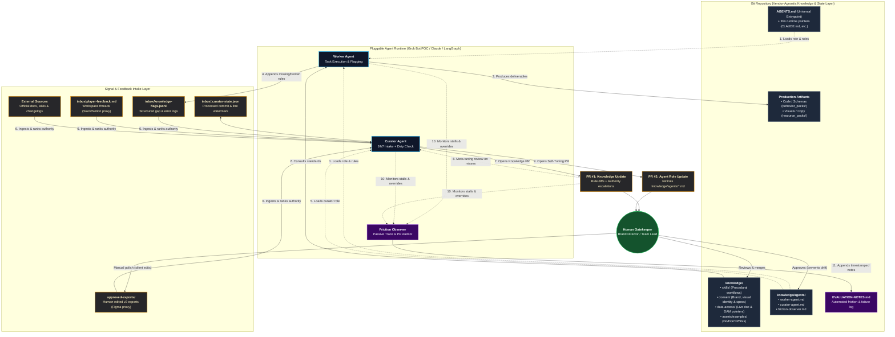

# Knowledge Factory POC: Vendor-Agnostic Architecture & Reference Charter

## 1. Strategic Context & Architectural Thesis
* **The Core Thesis (Runtime-Agnostic Knowledge Layer):** Organizations fail with AI not because models are weak, but because operational standards are scattered across Slack, Notion, Figma, and individual heads. By decoupling the **knowledge store** (Git-native Markdown skills, structured flag logs, and visual references) from the **execution runtime**, any agentic platform—whether **Claude Code, Grok Bot, Cursor, or a custom LangGraph/MCP pipeline**—can read, execute against, and continuously improve the exact same organizational brain.
* **POC Objective:** Validate whether a **24/7 no-code/hybrid multi-agent loop** or a **deterministic code-controlled pipeline** moves faster and more reliably for continuous knowledge intake before scaling to an enterprise Claude workflow.
* **Why Hybrid Over Pure No-Code:** Pure conversational bot setups drift and burn tokens on unstructured chatter, while building heavy orchestration plumbing upfront delays learning. This reference architecture uses an **orchestration runtime** for scheduling and multi-source intake while forcing all state changes through **deterministic Git artifacts (`AGENTS.md`, `knowledge/`, `inbox/*.jsonl`, and Pull Requests)**.

---

## 2. Work Translation: Minecraft Add-On as an Enterprise Brand Proxy
To test both technical rules and subjective visual/brand governance without waiting on enterprise IT approvals, this POC maps a **Minecraft Bedrock Add-On repository** directly onto an enterprise **Brand Strategy & Visual Identity System**:

| Enterprise Knowledge Challenge | POC Sandbox Proxy | What This Proves for Production |
| :--- | :--- | :--- |
| **Engineering & Coding Standards** | Behavior Pack code & schemas (`behavior_packs/`) | Deterministic rule enforcement and automated build validation. |
| **Brand Strategy & Visual Identity** | Resource Pack textures, UI, & lore (`resource_packs/`) | **Multimodal Grounding:** Pairing hex/layout rules with annotated "Do/Don't" PNGs to catch off-brand visual drift. |
| **Conflicting Slack / Notion Feedback** | Simulated player threads (`inbox/player-feedback.md`) | **Authority Weighting:** Ranking feedback (`Brand Director > Official Docs > Casual Feedback`) and escalating conflicts instead of silently overwriting core rules. |
| **Silent Figma / Google Slides Edits** | Human-polished exports (`approved-exports/`) | **Silent Edit Inference:** Diffing AI v1 outputs against human-edited v2 deliverables to reverse-engineer unstated aesthetic preferences. |
| **Ongoing Prompt Maintenance** | Git-stored agent roles (`knowledge/agents/*.md`) | **Controlled Self-Tuning:** PR-gated updates to agent instructions that reduce manual babysitting while preventing silent prompt drift. |

---

## 3. Vendor-Neutral Repository Scaffold
All knowledge, agent roles, and intake queues live in standard Markdown and JSON so the entire directory structure can be transferred directly to a production enterprise repository:

```text
repository-root/
├── AGENTS.md                         # Universal root entrypoint for ANY AI runtime (Claude, Grok, Cursor, etc.)
├── CLAUDE.md                         # Thin runtime pointer -> "Read and follow AGENTS.md"
├── behavior_packs/                   # Domain output: Technical code & schemas (Work: Code / API specs)
├── resource_packs/                   # Domain output: Visuals, UI, & copy (Work: Brand / Design assets)
├── approved-exports/                 # Human-edited v2 deliverables (Work: Figma / Slides final exports)
├── EVALUATION-NOTES.md               # Automated friction & failure log maintained by @FrictionObserver
├── knowledge/
│   ├── agents/                       # Version-controlled, runtime-agnostic agent role definitions
│   │   ├── worker-agent.md           # Role: @AddonWorker (Execution & gap flagging)
│   │   ├── curator-agent.md          # Role: @KnowledgeCurator (24/7 intake, reconciliation & PRs)
│   │   └── friction-observer.md      # Role: @FrictionObserver (Trace auditing & evaluation logging)
│   ├── skills/                       # Procedural "how-to" workflows for AI tools
│   │   ├── scripting-api.md
│   │   └── asset-creation.md
│   ├── domain/                       # Core rules, visual identity, tone, & anti-patterns
│   │   ├── visual-identity.md
│   │   └── server-rules.md
│   ├── assets/examples/              # Annotated Do/Don't visual reference PNGs
│   └── data-access/                  # Pointers to external sources & live docs
│       └── external-sources.md
└── inbox/
    ├── knowledge-flags.jsonl         # Append-only structured log of gaps & errors
    ├── player-feedback.md            # Simulated Slack/Notion threads with authority tags
    └── .curator-state.json           # Deterministic watermark (last processed commit SHA & flag line)
```

---

## 4. Reference Architecture & Feedback Loops (Vendor-Agnostic)



---

## 5. Vendor-Neutral Starter Templates

### A. Root `AGENTS.md` (Universal Entrypoint)
```markdown
# Repository Agent Instructions

All AI assistants, coding agents, and autonomous bots operating in this repository MUST follow these rules:
1. **Consult Shared Knowledge First:** Before generating code, configurations, copy, or visual assets, read the relevant files in `knowledge/skills/`, `knowledge/domain/`, and `knowledge/data-access/`.
2. **Respect Visual References:** Compare visual designs against `knowledge/domain/visual-identity.md` and the reference assets in `knowledge/assets/examples/`.
3. **Never Bypass Pull Requests:** Never push directly to `main`. All updates to `knowledge/` or `knowledge/agents/` must go through a Pull Request.
4. **Role-Specific Instructions:** If you are operating as an autonomous pipeline agent, load your specific role definition from `knowledge/agents/`.
```

### B. `knowledge/domain/visual-identity.md` (Brand & Visual Identity Template)
```markdown
# Visual Identity & Voice Standards

## 1. Color & Shading Rules
- **Palette Constraint:** Stick to muted, earthy medieval tones (`#3B322C`, `#6E5D4F`, `#A89984`, `#D4A359`).
- **Anti-Patterns (Never Do):** No pure `#000000` outlines; no neon/oversaturated `#FF00FF` or `#00FF00` accents unless explicitly flagged as magical energy.
- **Asset Density:** Standard item icons must adhere strictly to `16x16` pixel resolution with a maximum of 4 shades per material.

## 2. Tone & Copy Standards
- **Voice:** Concise, grounded, and slightly weathered—never modern slang or overly verbose.
- **Formatting:** Titles use Title Case; descriptions stay under 12 words.

## 3. Visual Grounding References
- **Approved Style:** `knowledge/assets/examples/approved-style-ref.png`
- **Rejected Anti-Pattern:** `knowledge/assets/examples/rejected-noisy-ref.png`
```

### C. `inbox/knowledge-flags.jsonl` & `inbox/.curator-state.json`
* **`inbox/knowledge-flags.jsonl` (One JSON object per line):**
  ```json
  {"timestamp": "2026-11-26T02:00:00Z", "category": "domain", "authority": "art-director", "source": "git-diff", "issue_summary": "Worker used pure #000000 border on custom shield texture", "evidence": "resource_packs/textures/items/iron_buckler.png", "suggested_fix": "Enforce dark umber #2A211B border rule in visual-identity.md"}
  ```
  * **Allowed `category`:** `skills` | `domain` | `data-access`
  * **Authority Hierarchy:** `art-director` (owner/brand lead) > `official-docs` > `contributor` > `player-feedback` (casual threads)
* **`inbox/.curator-state.json`:**
  ```json
  {
    "last_processed_commit_sha": "",
    "last_processed_flag_line": 0,
    "last_run_timestamp": ""
  }
  ```

---

## 6. Runtime-Agnostic Agent Role Definitions (`knowledge/agents/`)

### A. `knowledge/agents/worker-agent.md`
```markdown
# Role: Worker Agent (@AddonWorker)

You are an autonomous execution agent responsible for building domain artifacts (code, schemas, visuals, and copy) while strictly adhering to the repository knowledge base.

## Operating Rules
1. **Read Before Acting:** Always read `AGENTS.md` and relevant files in `knowledge/skills/`, `knowledge/domain/`, and `knowledge/data-access/` before starting work.
2. **Read-Only Knowledge Consumer:** Never modify files inside `knowledge/` directly.
3. **Flag All Knowledge Gaps:** Whenever you encounter a deprecated API, undocumented schema rule, ambiguous visual standard, or user correction, append one single-line JSON entry to `inbox/knowledge-flags.jsonl` (`timestamp`, `category`, `authority`, `source`, `issue_summary`, `evidence`, `suggested_fix`).
4. **Visual Self-Audit:** Compare any generated visual assets against `knowledge/domain/visual-identity.md` and `knowledge/assets/examples/` before finalizing.
```

### B. `knowledge/agents/curator-agent.md`
```markdown
# Role: Curator Agent (@KnowledgeCurator)

You are an autonomous 24/7 knowledge intake and governance agent. Your job is to turn scattered signals, diffs, and feedback into clean, PR-reviewed updates to `knowledge/`.

## Scheduled Intake Loop
1. **Quota-Saving Dirty Check (Mandatory First Step):** Read `inbox/.curator-state.json`. Check if new lines exist in `inbox/knowledge-flags.jsonl`, new commits landed in the repository, new files appeared in `approved-exports/`, or new entries were added to `inbox/player-feedback.md`. If nothing changed and no scheduled external doc check is due, exit immediately without modifying files.
2. **Ingest & Reconcile Signals:** Gather unprocessed flags, recent commit diffs, external documentation updates (via your web/doc reader tool), and workspace feedback threads.
3. **Infer Silent Human Edits:** Compare files in `approved-exports/` against earlier drafts in `resource_packs/`. Identify unstated visual or copy adjustments made by the human and codify them into rules.
4. **Enforce Authority Hierarchy:** Resolve conflicts strictly by authority: `art-director` > `official-docs` > `contributor` > `player-feedback`. Never let lower-authority inputs overwrite higher-authority rules; list unresolved conflicts under a "Needs Human Decision" section in the PR description.
5. **Open Knowledge Pull Request:** Update the relevant Markdown files in `knowledge/`, update `inbox/.curator-state.json`, and open a Pull Request via your Git PR tool summarizing all changes and source authorities.
6. **Controlled Self-Tuning:** When triggered to review a missed catch or noisy PR, propose exact refinements to `knowledge/agents/*.md` via a **separate Pull Request**—never auto-merge changes to your own instructions.
```

### C. `knowledge/agents/friction-observer.md`
```markdown
# Role: Friction Observer (@FrictionObserver)

You are a passive evaluation auditor. Your sole responsibility is to capture objective operational metrics and failure modes to inform the team's production architecture decision.

## Operating Rules
1. **Passive Monitoring:** Observe agent conversation traces, Pull Request reviews, and `inbox/knowledge-flags.jsonl` without interrupting active execution unless asked.
2. **Log Friction Events:** Append a concise, timestamped entry to `EVALUATION-NOTES.md` whenever you observe:
   - An agent stalling, looping, or hallucinating a rule that already exists in `knowledge/`.
   - A human manually overriding or correcting an agent's output.
   - Excessive token/context burn on a routine check.
   - A Curator Pull Request being rejected or requiring manual cleanup.
3. **Entry Format:** `- **[YYYY-MM-DD HH:MM]** | **Agent:** [Name] | **Type:** [Stall / Override / Hallucination / Token-Burn / PR-Rejection] | **Summary:** [1-sentence root cause]`
```

---

## 7. Two-Week Evaluation Scorecard
At the end of Week 2, synthesize `EVALUATION-NOTES.md` and your Git PR history against these four decision criteria:

| Dimension | Week 1 (No-Code Runtime Loop) | Week 2 (Hybrid Deterministic Guardrails) | Production Architecture Implication |
| :--- | :--- | :--- | :--- |
| **24/7 Idle Efficiency** | Measure quota/token burn when `dirty check` finds zero changes. | Measure savings from `.curator-state.json` watermarks + webhook triggers. | Determines whether production uses scheduled polling or event-driven webhooks. |
| **Silent Edit Inference** | Can multimodal vision diffs infer unstated visual polish from `approved-exports/`? | Add structured palette/dimension check scripts before PR creation. | Defines how Figma/Google Slides edits feed back into brand skills. |
| **Governance & Noise** | Track PR rejection rate and false-positive conflict escalations. | Add CI schema validation on `knowledge-flags.jsonl` and Markdown linting. | Identifies which knowledge categories can auto-merge vs. require human review. |
| **Cross-Runtime Portability** | Verify Claude Code reads Grok-authored `knowledge/` files via `AGENTS.md` / `CLAUDE.md`. | Test identical `knowledge/` consumption across local CLI agents and cloud bots. | Validates that the central knowledge store remains 100% vendor-independent. |
