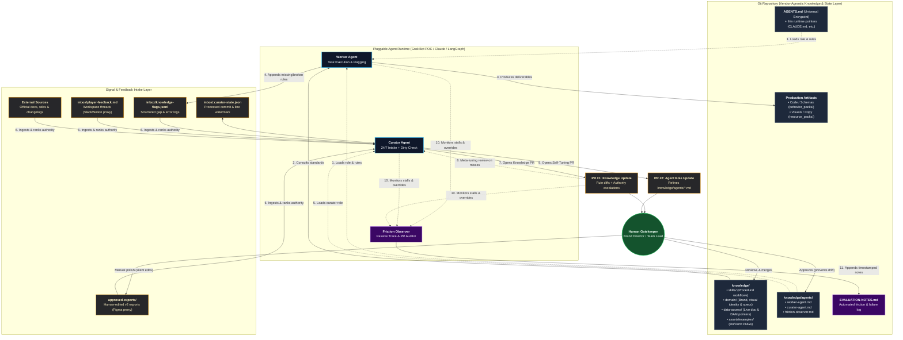

# Project Brief: Autonomous Knowledge Factory
**A Vendor-Agnostic Architecture for Self-Maintaining AI Standards**

---

### 1. Executive Summary
Organizations rarely fail with AI due to weak models—they fail because institutional knowledge (brand strategy, visual identity, design systems, and engineering standards) is scattered across Slack, Notion, Figma, and individual heads.

This initiative prototypes an **Autonomous Knowledge Factory**: a multi-agent system that continuously ingests scattered updates, reconciles conflicting feedback, and maintains version-controlled Markdown skills (`SKILL.md`) that **any AI runtime**—including our organization's existing **Claude** ecosystem—can reliably consume.

---

### 2. Core Objectives & Goal Outcomes
The primary objective is to determine whether a **no-code/hybrid multi-agent setup** or a **deterministic code-controlled pipeline** allows our team to move fastest when building an org-wide, 24/7 knowledge intake system.

#### Target Outcomes
1. **Establish a Vendor-Agnostic Knowledge Layer:** Store all standards, visual references, and agent role definitions in standard Git-native Markdown and JSON (`AGENTS.md` + `knowledge/`) so the knowledge base is 100% portable across Claude, Grok, Cursor, or custom code pipelines.
2. **Validate 24/7 Continuous Knowledge Intake:** Prove that an autonomous "Curator" agent can wake up on a schedule, inspect new feedback and diffs using a lightweight state watermark, and open clean pull requests updating core guidance. The worker, the curator, and the observer all use branches and pull requests into `main`. Nobody pushes to `main`. Pack work uses `feat/<name>` or `fix/<name>` with `feat(pack):` / `fix(pack):`. Knowledge uses `chore/knowledge-<topic>` with `chore(knowledge):`. Agent instructions use `meta/agents-<topic>` with `meta(agents):`. Evaluation notes use `docs/eval-<topic>` with `docs(eval):`. Game branch rules in the Crew repo stay `CLAUDE.md` rules 2 and 3.
3. **Test Multi-Source Governance & Conflict Resolution:** Enforce strict authority hierarchies so casual workspace chatter cannot overwrite official brand or engineering standards.
4. **Evaluate Controlled Self-Tuning & Observability:** Use a passive observer agent (`@FrictionObserver`) to log execution friction automatically, and test PR-gated self-tuning (`knowledge/agents/*.md`) to reduce ongoing prompt maintenance without risking silent drift.
5. **Deliver an Architecture Decision Scorecard:** Produce concrete data on setup speed, idle token efficiency, multimodal accuracy, and human-in-the-loop governance to guide our team's production engineering roadmap.

---

### 3. Reference Workflow & Feedback Loops

---

### 4. Low-Risk Sandbox Strategy
To move immediately without waiting on enterprise IT approvals or risking live brand assets, the POC uses an active **Minecraft Bedrock Add-On repository** as a structural proxy for an enterprise **Brand Strategy & Visual Identity System**:

| Enterprise Knowledge Challenge | POC Sandbox Equivalent | What It Proves for Work |
| :--- | :--- | :--- |
| **Engineering & Design Rules** | Behavior Pack code & schemas (`behavior_packs/`) | Deterministic rule enforcement and automated validation. |
| **Brand & Visual Identity** | Resource Pack textures, UI, & lore (`resource_packs/`) | Multimodal grounding using color palettes, tone rules, and annotated "Do/Don't" visual examples. |
| **Conflicting Slack Feedback** | Simulated player threads (`inbox/player-feedback.md`) | Authority weighting (`Brand Director > Official Docs > Casual Feedback`) and conflict escalation. |
| **Silent Figma / Slide Edits** | Human-polished exports (`approved-exports/`) | Inferring unstated design preferences by diffing AI v1 drafts against human-edited v2 exports. |
| **Ongoing Prompt Maintenance** | Git-stored agent roles (`knowledge/agents/*.md`) | PR-gated self-tuning (`PR #2`) that improves accuracy over time without opaque UI edits or prompt drift. |

---

### 5. Two-Week Execution Plan & Deliverables
* **Week 1 — Pure No-Code Multi-Agent Loop:** Deploy `@AddonWorker`, `@KnowledgeCurator`, and `@FrictionObserver` against the vendor-neutral repository (`AGENTS.md` + `knowledge/`).
* **Week 2 — Hybrid Deterministic Guardrails:** Introduce strict JSON schemas, `.curator-state.json` watermarks to minimize idle token burn, automated validation checks before PR creation, and PR-gated self-tuning.
* **Final Deliverable (Team Readout):** A portable reference repository demonstrating automated knowledge PRs alongside an **Architecture Decision Scorecard** defining what to keep no-code versus what to build in deterministic code for our team's production rollout.
