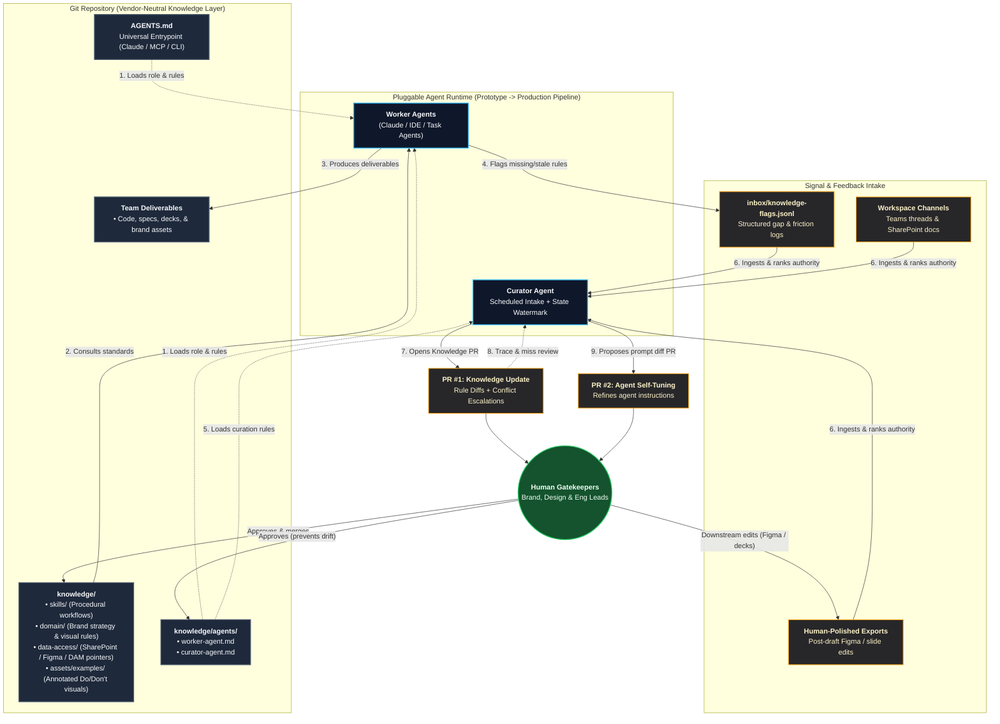

# Initiative Intake Brief: Autonomous Knowledge Factory
**Building a Self-Maintaining Brand, Design & Engineering Knowledge Layer for AI**

---

### 1. Problem Statement
Our AI tools (including Claude) are only as effective as the institutional context they can reliably access. Today, critical organizational knowledge—brand strategy, visual identity rules, design system standards, and tacit "how we work" workflows—is scattered across **Teams, SharePoint, Figma, and individual heads**.

Manually curating documentation for AI agents does not scale: static wikis quickly go stale, prompts drift across teams, and every manual correction a designer or engineer makes to an AI draft is lost rather than feeding back into our shared system.

---

### 2. Proposed Concept: The Knowledge Factory
Rather than asking humans to manually maintain AI instructions forever, we propose building an **Autonomous Knowledge Factory**—a vendor-neutral, version-controlled knowledge repository (`AGENTS.md` + structured Markdown skills) maintained by a continuous intake and curation loop:

1. **Agents Consume & Flag Gaps:** As team members use AI tools to draft specs, presentations, code, or visual assets, agents read from our central knowledge store and log structured flags whenever rules are missing, ambiguous, or corrected by a human.
2. **Continuous 24/7 Intake & Reconciliation:** A scheduled **Curator Agent** wakes up automatically to ingest new flags, Teams critique threads, SharePoint updates, and human-edited exports (e.g., manual polish made in Figma or slide decks).
3. **Human-Gated Governance:** The Curator resolves conflicts using a clear authority hierarchy and opens clean **Pull Requests** for human sign-off before any rule updates go live. The worker and the friction observer use pull requests too. Nothing in this loop is pushed straight to `main`. In the Crew sandbox, branch names are `feat/<name>` and `fix/<name>` for the game (`CLAUDE.md` rules 2 and 3), `chore/knowledge-<topic>`, `meta/agents-<topic>`, and `docs/eval-<topic>`.

---

### 3. How Knowledge Is Structured
To keep agent context lightweight, auditable, and easy to govern across disciplines, the knowledge store separates institutional memory into three distinct categories:

* **`skills/` (Procedural Memory — *How to Do the Work*):** Step-by-step workflows, checklists, and scripts for executing tasks according to our standards (e.g., how to structure an executive presentation, audit a Figma component, or write a technical spec).
* **`domain/` (Semantic Memory — *How the Business & Brand Work*):** Stable, long-lived core rules—such as brand strategy pillars, visual identity tokens, tone-of-voice guidelines, audience personas, and explicit anti-patterns.
* **`data-access/` (Routing Guidance — *Where Live Information Lives*):** Pointers, query rules, and MCP/connector instructions telling AI tools where to fetch fast-changing source material (SharePoint libraries, Figma files, DAM assets, or data tables) without duplicating heavy binary files inside Git.

---

### 4. Target Architecture & Feedback Loops

---

### 5. Key Design Principles
* **Vendor-Neutral Knowledge Layer:** By storing rules as plain Markdown and JSON in Git behind a universal `AGENTS.md` entrypoint, our knowledge outlives any single model or vendor and plugs directly into our existing **Claude** tooling via Git or MCP.
* **Multimodal Grounding:** Visual identity cannot rely on text rules alone. `domain/` and `assets/examples/` pair semantic tokens with annotated "Do/Don't" visual references so agents can self-check aesthetic alignment.
* **Authority-Weighted Governance:** Incoming signals are ranked by source authority (`Brand & Design Leadership > Official SharePoint Docs > Team Contributors > Casual Chat`). Unresolved conflicts are escalated in PR descriptions rather than silently overwriting core standards.
* **Controlled Self-Tuning:** Agent operating instructions (`knowledge/agents/`) live in Git and can only be updated via human-approved Pull Requests—allowing the system to improve from past misses without silent prompt drift.

---

### 6. Phased Rollout Path
* **Phase 1 — Sandbox Validation (In Progress):** Validate the dual-agent loop, schema design, multimodal grounding, and PR governance in an isolated sandbox repository to benchmark no-code vs. deterministic code trade-offs.
* **Phase 2 — Internal Pilot (Single Domain):** Stand up a pilot repository for one high-leverage workflow (e.g., design system component guidance or brand presentation templates) connected to our team's Claude environment.
* **Phase 3 — Production Intake Pipeline:** Harden the Curator intake loop with deterministic code guardrails, automated trace observability, and direct connectors to Teams, SharePoint, and Figma.

---

### 7. Discussion & Alignment Questions for Intake
1. **First Pilot Domain:** Which recurring workflow or guidance category (e.g., visual identity tokens, deck/copy standards, or component specs) would deliver the highest immediate value for a Phase 2 pilot?
2. **Source Systems & Access:** Which Teams channels, SharePoint libraries, or Figma files should be designated as authoritative intake sources?
3. **Approval Ownership:** Who should serve as the designated PR reviewers for `domain/` (core brand/strategy rules) versus `skills/` (procedural workflows)?
